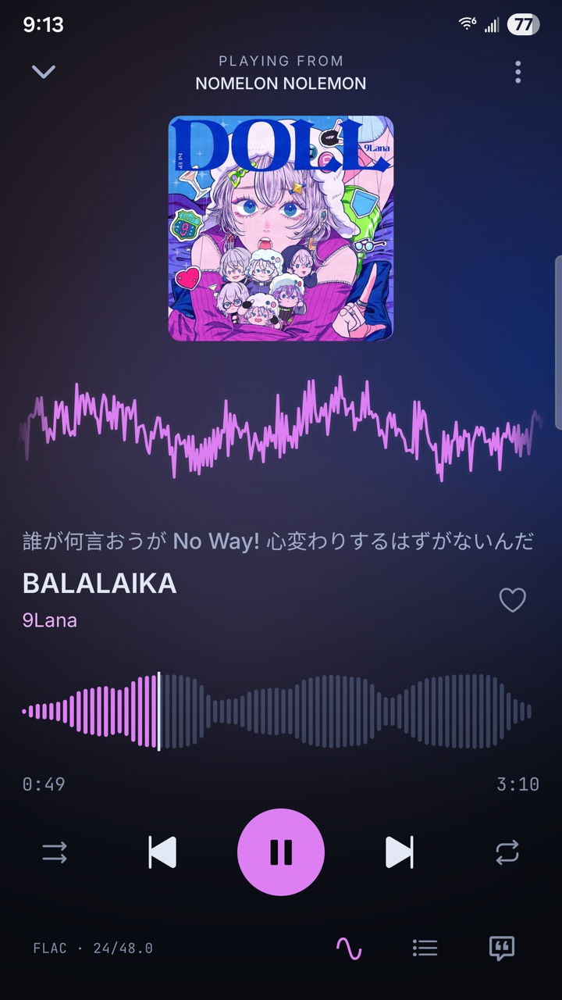
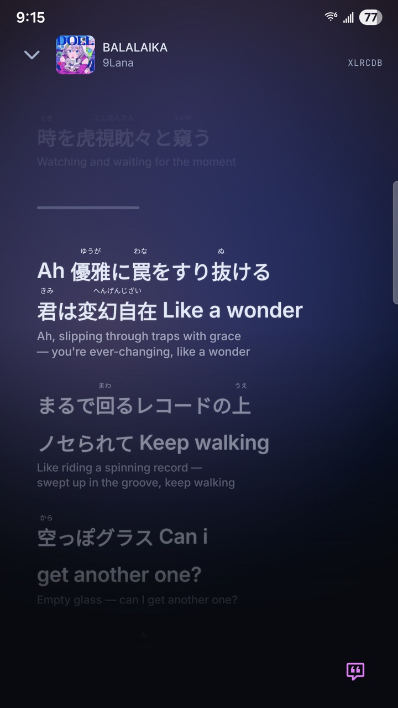
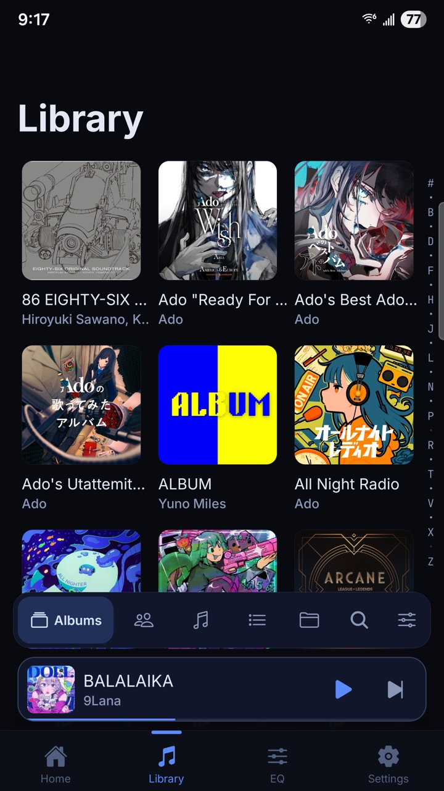
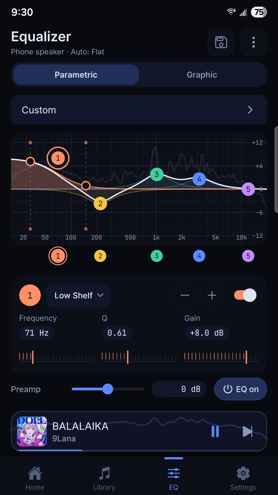
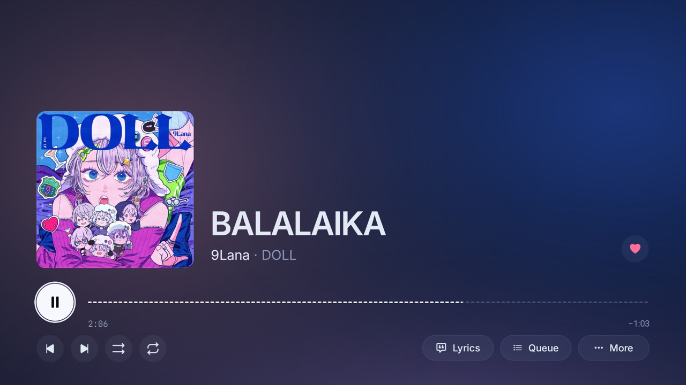
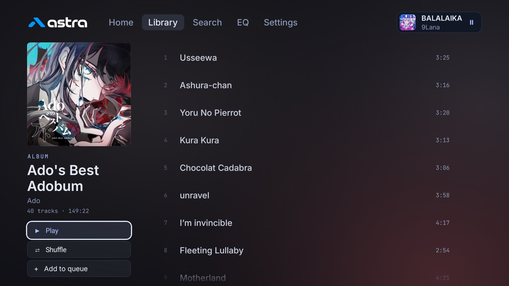

# Astra Mobile


[Google Play](https://play.google.com/store/apps/details?id=io.github.boof2015.astra) · [Releases](https://github.com/Boof2015/astra-mobile/releases) · [Astra for desktop](https://github.com/Boof2015/astra) · [Privacy](PRIVACY.md)

Astra Mobile is a music player for Android. It plays your local files and your Subsonic or Jellyfin servers as one library, on phones, tablets, Android Auto and Android TV. It's the mobile counterpart to [Astra for desktop](https://github.com/Boof2015/astra), and the two can pair over your local network.

<p align="center">
  
  
  
  
</p>
<p align="center">
  <em>Astra on Android phones</em>
</p>
<p align="center">
  
  
</p>
<p align="center">
  <em>Astra on Android TV</em>
</p>

## Highlights

**Astra Resolve** makes sense of inconsistent artist and album tags. It uses evidence from across your library to distinguish collaborations from artist names that contain punctuation, so `Tyler, the Creator` stays one artist while `Ado, Eve` becomes two. It also keeps albums together when Album Artist tags are incomplete, without merging uncertain matches. It's the same engine as Astra for desktop, working entirely locally without external metadata lookups or changes to your files.

**[XLRC](https://github.com/Boof2015/xlrc)** is an open lyrics format developed alongside Astra. It extends LRC with word-by-word timing, furigana, translations and singer labels, and Astra renders all of them. Its community database, [XLRCDB](https://astramusic.dev/xlrcdb/), is built in.

**[Astra Signal](https://github.com/Boof2015/astra-signal)** turns a song into a scannable code drawn as an audio spectrum. The code carries the artist, title and duration itself, with no account or streaming-service ID behind it. Scanning one finds that song in your library.

## Features

### Playback and sound

- 10-band parametric EQ, edited by dragging bands directly on the response curve over a live spectrum
- Five-band graphic EQ mode
- AutoEQ profile import
- EQ presets shared and scanned as QR codes
- Loudness normalization to −14 LUFS by default, using ReplayGain tags when present and measuring tracks without them
- Gapless playback
- Dolby Atmos playback on phones that support it, with Atmos tracks marked in the library
- Audio device screen showing the format at each stage from the file to Android's output
- Sleep timer, including custom durations

### Player

- Waveform seek bar for local tracks
- Spectrum analyzer and oscilloscope visualizers
- Colors drawn from the album art
- Live lyric preview line
- Swipe the artwork to skip tracks
- Queue with drag-to-reorder
- Format, bit depth and sample rate shown on the player and in track lists

### Library

- Local folders and Subsonic or Jellyfin servers in one library
- Browse by album, artist, track, playlist or folder, with sorting and jump-to-letter
- One search across tracks, albums, artists, playlists and settings
- Swipe a track right to play it next, or left to add it to the queue
- Favorites, playlists, and rule-based dynamic playlists
- M3U playlist import and export
- Artwork viewer on album, artist and playlist pages
- Artist images from local files or, optionally, Deezer

### Lyrics

- Synced lyrics from `.lrc` and `.xlrc` files, embedded tags, XLRCDB and LRCLIB
- Word-by-word timing, furigana, translations and singer labels from XLRC

### Listening history

- Home with Recently Played, Recently Added, favorites, playlists and a weekly listening summary
- A random album or artist pick on Home, avoiding recent repeats
- Stats tab ranking top tracks, artists and albums by plays or listening time
- Listening activity chart over a chosen range
- Pausable listening history
- Scrobbling to Last.fm, Last.fm-compatible servers such as Libre.fm, and ListenBrainz, with multiple destinations at once

### Desktop integration (experimental)

- Pairing by QR code, LAN discovery or manual address
- Choose whether music plays on your phone or on the desktop
- Control the desktop's playback and queue
- Favorites and playlists sync in both directions

### Beyond the phone

- Android TV interface built for the remote, with an ambient display mode
- Android Auto
- Tablet and foldable layouts with the player docked beside the library, and a navigation rail in landscape
- Customizable home-screen widgets in four color styles, drawn from the album art
- System, Light, Dark, AMOLED and Material You themes, with a choice of accent colors
- Discord Rich Presence, off by default

## Install

<a href="https://play.google.com/store/apps/details?id=io.github.boof2015.astra"></a>
<a href="https://github.com/Boof2015/astra-mobile/releases/latest"></a>

Signed APKs are also published on [Releases](https://github.com/Boof2015/astra-mobile/releases). Both are signed with the same key, so either can update the other. Astra requires Android 7.0 or later.

## Privacy

Astra has no accounts, analytics or crash reporting. Every network feature is optional, and [PRIVACY.md](PRIVACY.md) documents what each one sends.

## Building from source

Astra is built with React Native and Expo, with native Kotlin and C++ modules for playback, library scanning and visualization.

Requirements: Node.js 22, JDK 17, and the Android SDK and NDK.

```sh
git clone https://github.com/Boof2015/astra-mobile.git
cd astra-mobile
npm ci
npx expo prebuild --platform android --no-install
cd android
ASTRA_DISCORD_ENABLED=false ./gradlew :app:assemblePreview -PreactNativeArchitectures=arm64-v8a
```

This produces a preview build signed with a development key. It installs as **Astra Dev**, alongside the release app.

- **Last.fm:** API credentials go in `.env`; see [`.env.example`](.env.example).
- **Discord Rich Presence:** requires Discord's proprietary SDK, which isn't distributed here; see [docs/discord-build.txt](docs/discord-build.txt).
- **Release builds:** see [docs/android-optimization.md](docs/android-optimization.md).

## Support

If you find Astra useful and want to support a broke college student, consider supporting development:

[](https://ko-fi.com/boof2015)

## License

Astra Mobile is licensed under [GPL-3.0-only](LICENSE), with an [additional permission](LICENSE-DISCORD-EXCEPTION) for linking with the Discord Social SDK. The SDK is not part of this repository and has its own terms. Third-party components retain their own licenses; their full texts are in the app under Settings > Info > Licenses. The "Get it on GitHub" badge is by [flocke](https://gitlab.com/fdroid/artwork/-/tree/master/badge/src), licensed under CC-BY-SA 3.0.
